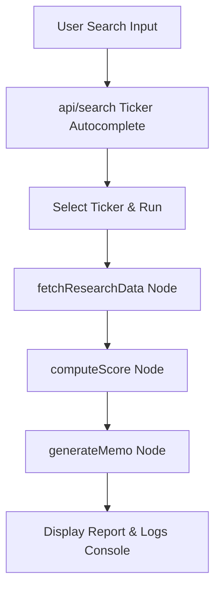

# AI Investment Research Agent

A modern, high-fidelity web application built with **Next.js (App Router)** and **TypeScript** that resolves stock tickers, fetches real-time financials and news, calculates a deterministic fundamental score, and synthesizes a structured investment memo with a final recommendation: **Invest, Watch, or Pass**.

## 🌟 Key Features

1. **Deterministic Scoring Engine (Hybrid Logic)**: A local rule-based engine computes Growth, Profitability, Valuation, Risk, and Headlines Sentiment scores. The LLM does not hallucinate these scores; it only explains and synthesizes the final narrative.
2. **Robust Data Grounding**: Leverages `yahoo-finance2` for zero-setup, real-time financial metrics, historical income statement data, and news headlines. Full support for **Indian Stocks** (e.g. Tata Motors, Reliance) and global stocks.
3. **Resilient Multi-Model Strategy**:
   - **Primary**: Google Gemini API (`gemini-2.5-flash`) via the new `@google/genai` SDK.
   - **Fallback**: Groq API (`llama-3.3-70b-versatile`) via the `groq-sdk` package in case of timeouts, rate-limits, or quota failures.
4. **Premium UX**: Custom HSL-based dark mode theme with glassmorphic cards, step-by-step agent execution loaders, radial glowing backdrops, and interactive category progress meters.
5. **Transparency Trace**: An expandable developer console renders the step-by-step execution logs of the agent flow directly in the UI.

---

## 🛠️ Architecture & Agent Flow

The agent flow runs as a lightweight, typed 3-node state machine in a Next.js Server Function/API endpoint:



### 1. `fetchResearchData` Node
- Resolves search queries (e.g. "Tata Motors") to exchange tickers (e.g. `TATAMOTORS.NS`).
- Fetches real-time price info, profile details (sector, description), fundamental metrics, and the last 3-4 years of annual financial statements.
- Fetches recent news headlines.

### 2. `computeScore` Node
Deterministic scoring calculations (0 to 100):
- **Growth (25% weight)**: Calculated on YoY revenue and net income growth.
- **Profitability (25% weight)**: Calculated on operating margin and return on equity (ROE).
- **Risk (20% weight)**: Calculated on debt-to-equity (leverage) and current ratio (liquidity), penalized for high Beta volatility.
- **Valuation (20% weight)**: Calculated on trailing P/E and PEG ratios.
- **Sentiment (10% weight)**: Keyword analysis of news headlines for positive/negative triggers.
- **Data Confidence**: Computes percentage of expected data fields successfully retrieved.

### 3. `generateMemo` Node
- Constructs a structured markdown-aligned prompt with all facts.
- Enforces strict JSON schemas for outputs.
- Calls Gemini first; if it fails or times out (15s limit), retries once, then falls back to Groq (with a retry limit of 2).

---

## ⚙️ Setup & Run Instructions

### 1. Prerequisites
- Node.js v18 or later.
- NPM, PNPM, or Yarn.

### 2. Environment Variables
Create a `.env.local` file at the root of the project and add your API keys:

```env
# Google Gemini API key (Primary LLM)
GEMINI_API_KEY=your_gemini_api_key_here

# Groq Console API key (Fallback LLM)
GROQ_API_KEY=your_groq_api_key_here
```

### 3. Run Locally
```bash
# Install dependencies
npm install

# Run the development server
npm run dev
```
Open [http://localhost:3000](http://localhost:3000) in your browser.

### 4. Build for Production
```bash
npm run build
npm run start
```

---

## ⚖️ Trade-offs & Limitations

1. **Unofficial Data Source**: We use `yahoo-finance2`, which scrapes Yahoo's public endpoints. It is free and requires no developer keys, but can be subject to rate limits or formatting changes.
2. **Missing Sector Benchmarking**: In v1, valuation scores are absolute (e.g., PE < 15 is good). A premium improvement would be to compare metrics against industry/sector peers.
3. **Keyword Sentiment Scorer**: The sentiment score uses a fast, local keyword dictionary rather than LLM classification to save API costs and prevent latency spikes.

---

## 📈 Example Ticker Configurations

- **Tata Motors**: Enter `TATAMOTORS.NS` (or type "Tata Motors" in search)
- **Reliance Industries**: Enter `RELIANCE.NS` (or type "Reliance")
- **Infosys**: Enter `INFY.NS` (or type "Infosys")
- **Apple Inc.**: Enter `AAPL`
- **Tesla Inc.**: Enter `TSLA`

---

## 🚀 Future Enhancements
- Interactive historical price line charts (e.g. using `recharts`).
- SEC filing / annual report PDF scraping with vector embeddings for deeper qualitative insights.
- Peer group comparison widget.
- Saved research history local store.
